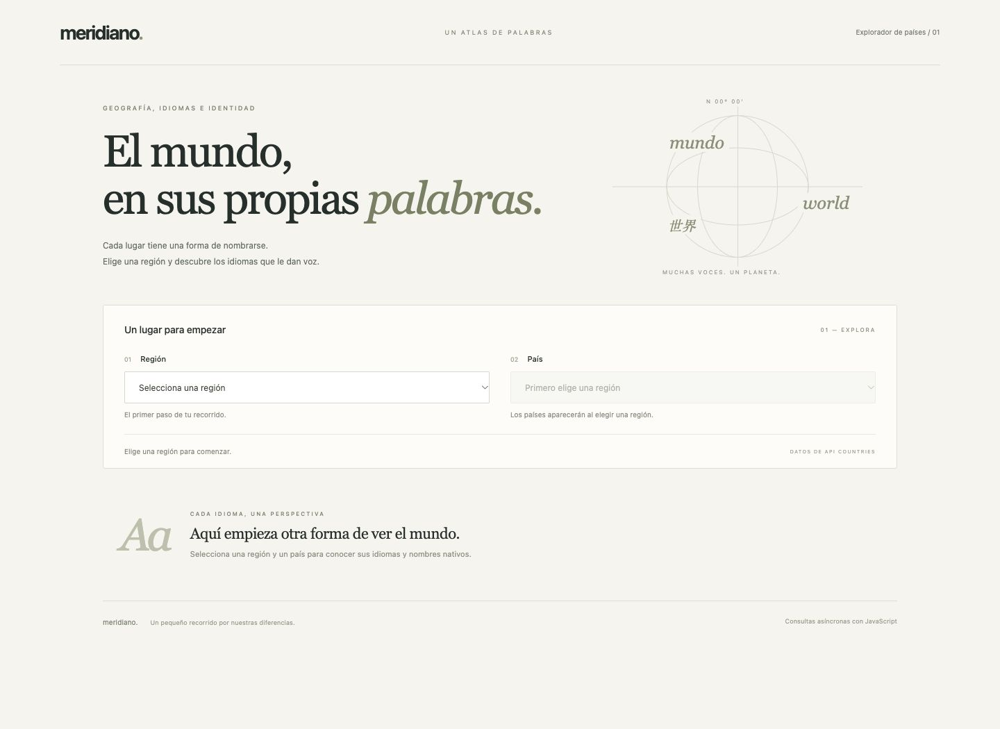
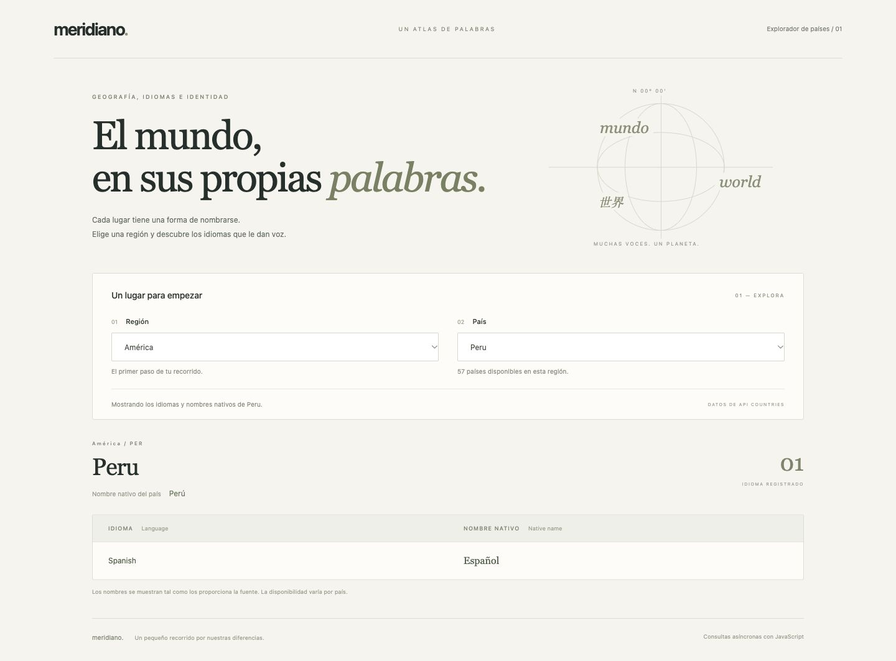
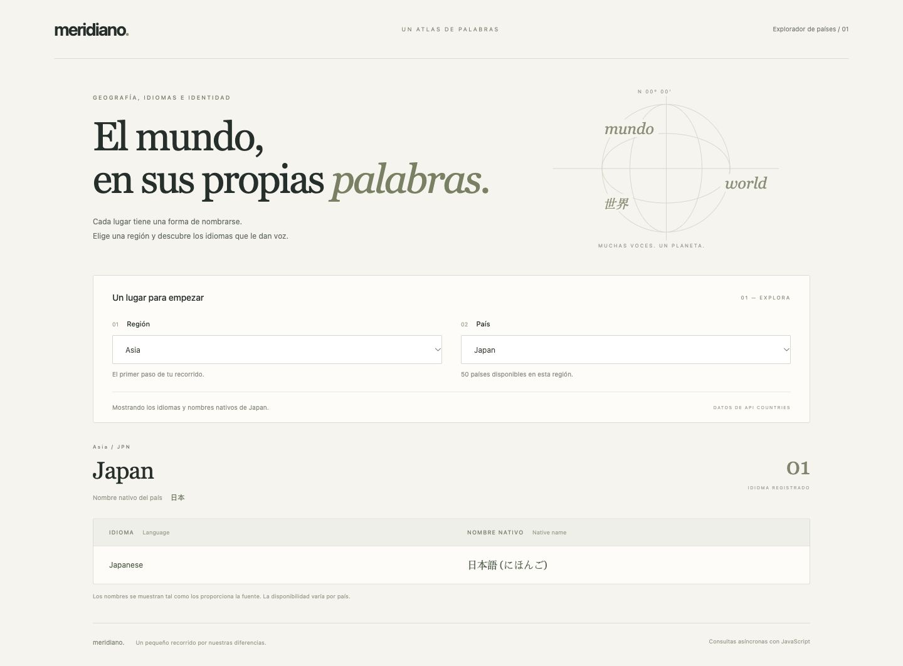

<div align="center">
  <table>
    <thead>
      <tr>
        <th>
          
        </th>
        <th>
          <strong>UNIVERSIDAD LA SALLE DE AREQUIPA</strong><br />
          <strong>FACULTAD DE INGENIERÍAS Y ARQUITECTURA</strong><br />
          <strong>DEPARTAMENTO ACADÉMICO DE INGENIERÍA Y MATEMÁTICAS</strong><br />
          <strong>CARRERA PROFESIONAL DE INGENIERÍA DE SOFTWARE</strong>
        </th>
      </tr>
    </thead>
  </table>
</div>

<div align="center">
  <h1>LLAMADAS ASÍNCRONAS CON JAVASCRIPT</h1>
  <strong>Tecnologías de Construcción de Software</strong><br />
  <strong>Profesor: Luis Enrique Patiño Herrera</strong>
</div>

---

## Descripción

**Meridiano** es un explorador de países e idiomas con dos listas desplegables dependientes. Al elegir una región, consulta sus países de forma asíncrona; al elegir un país, muestra una tabla con los idiomas y sus nombres nativos. También presenta el nombre nativo del país para distinguir ambos conceptos.

Diseño personalizado y minimalista, sin iconos ni bibliotecas de interfaz: fondo cálido, tipografía editorial, tonos oliva y una composición tipográfica realizada en CSS. Los recursos de la aplicación no dependen de fuentes o imágenes externas.

## Tecnologías utilizadas

- HTML y CSS: estructura, diseño adaptable y controles accesibles.
- JavaScript: módulos ES, `fetch`, `async/await` y `AbortController`.
- API Countries: datos reales por región.
- Node.js: pruebas automatizadas con `node:test`.
- Python 3: servidor HTTP local para los módulos del navegador.

## Ejecución

Desde la raíz del proyecto:

```bash
python3 -m http.server 8001
```

Abrir [http://localhost:8001](http://localhost:8001).

Alternativamente, con Node.js y Python 3 instalados:

```bash
npm start
```

No es necesario ejecutar `npm install`. Node.js no es el servidor de la aplicación ni ejecuta sus consultas: la aplicación funciona en el navegador. Se necesita conexión para consultar la API y un servidor HTTP para cargar los módulos; no abrir con `file://`.

## Fuente de datos

Se utiliza la alternativa API Countries permitida por la consigna. El dominio `www.apicountries.com` redirige actualmente a `countries.dev`; el proyecto consulta directamente su destino para evitar problemas de redirección entre orígenes:

```text
GET https://countries.dev/region/americas
GET https://countries.dev/region/asia
```

[Documentación de consultas por región](https://www.apicountries.com/docs/api/region).

REST Countries v3.1 fue verificada durante el desarrollo y respondió con un aviso de descontinuación, por lo que no se utiliza en esta implementación. Las regiones son estáticas, como permite la alternativa de la consigna: África, América, Asia, Europa, Oceanía y Polar.

Los nombres se conservan tal como los devuelve la fuente; no se inventan traducciones ni idiomas ausentes. La disponibilidad y la vigencia de los datos dependen del servicio externo.

## Funcionamiento

```text
Seleccionar región
      ↓
ControladorPaises → ConsultarPaises → RepositorioPaises
                                          ↓
                                    fetch + await
                                          ↓
Respuesta JSON → modelo de dominio → lista de países
                                          ↓
                               Seleccionar país
                                          ↓
                       Tabla de idiomas y nombres nativos
```

Cada cambio de región dispara una nueva consulta y limpia el país y la tabla anteriores. El selector de países se deshabilita durante la carga. La respuesta regional ya contiene los idiomas, por lo que seleccionar un país actualiza la tabla sin otra solicitud.

Se muestran estados de carga, error y ausencia de datos. Una consulta fallida ofrece un botón para reintentar. Se cancelan consultas anteriores y se ignoran respuestas desactualizadas; el tiempo de espera máximo es de 15 segundos.

## Arquitectura y buenas prácticas

Todos los archivos se encuentran en la raíz del proyecto.

| Archivo | Capa y responsabilidad |
|---|---|
| `dominio.js` | Modelo de país, normalización de idiomas y catálogo de regiones. |
| `consultar-paises.js` | Caso de uso para consultar una región válida. |
| `repositorio-paises.js` | Adaptador HTTP que transforma la respuesta externa al modelo propio. |
| `controlador-paises.js` | Coordinación del flujo, cancelación y control de concurrencia. |
| `vista-paises.js` | Actualización del DOM, selectores, mensajes y tabla. |
| `aplicacion.js` | Composición de dependencias y conexión de eventos. |
| `index.html` | Estructura accesible. |
| `estilos.css` | Diseño personalizado y adaptable. |
| `pruebas.test.js` | Pruebas del dominio, repositorio, caso de uso y controlador. |

Se aplican principios SOLID según el alcance: responsabilidad única por componente, dependencias recibidas por constructor y un contrato pequeño de repositorio (`obtenerPorRegion`) que permite cambiar el proveedor sin modificar el caso de uso. El dominio y el caso de uso no dependen del DOM ni de `fetch`. El controlador recibe una vista que se sustituye en las pruebas, y el repositorio recibe su función de consulta.

Se utilizan nombres propios en español, `textContent` para representar datos con seguridad y `bdi` para aislar nombres en diferentes direcciones de escritura. La interfaz incluye etiquetas, ayudas, anuncios de estado, navegación por teclado, foco visible y respeto a la preferencia de movimiento reducido.

## Resultado esperado

Al seleccionar **América** y luego **Peru**:

| Language | Native name |
|---|---|
| Spanish | Español |

Nombre nativo del país: **Perú**.

Al seleccionar **Asia** y luego **Japan**:

| Language | Native name |
|---|---|
| Japanese | 日本語 (にほんご) |

Nombre nativo del país: **日本**.

Estos resultados corresponden a la respuesta observada durante la comprobación; no pretenden constituir un inventario exhaustivo de los idiomas hablados en cada país.

## Comprobación

```bash
npm test
```

Seis pruebas automatizadas verifican la normalización de datos, el rechazo de regiones inválidas, la señal de cancelación y ordenamiento, los errores HTTP y de formato, el descarte de respuestas antiguas y el estado de reintento.

También se verificó en el navegador la consulta real de América y Perú y el cambio a Asia y Japón, con recarga del selector y limpieza del resultado anterior.

## Evidencia de funcionamiento

### Pantalla inicial



### América y Perú



### Asia y Japón


